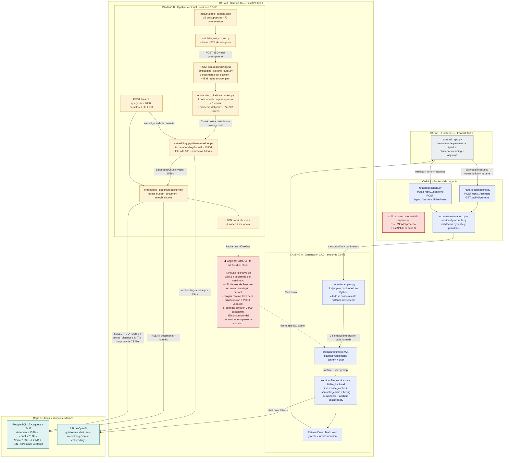
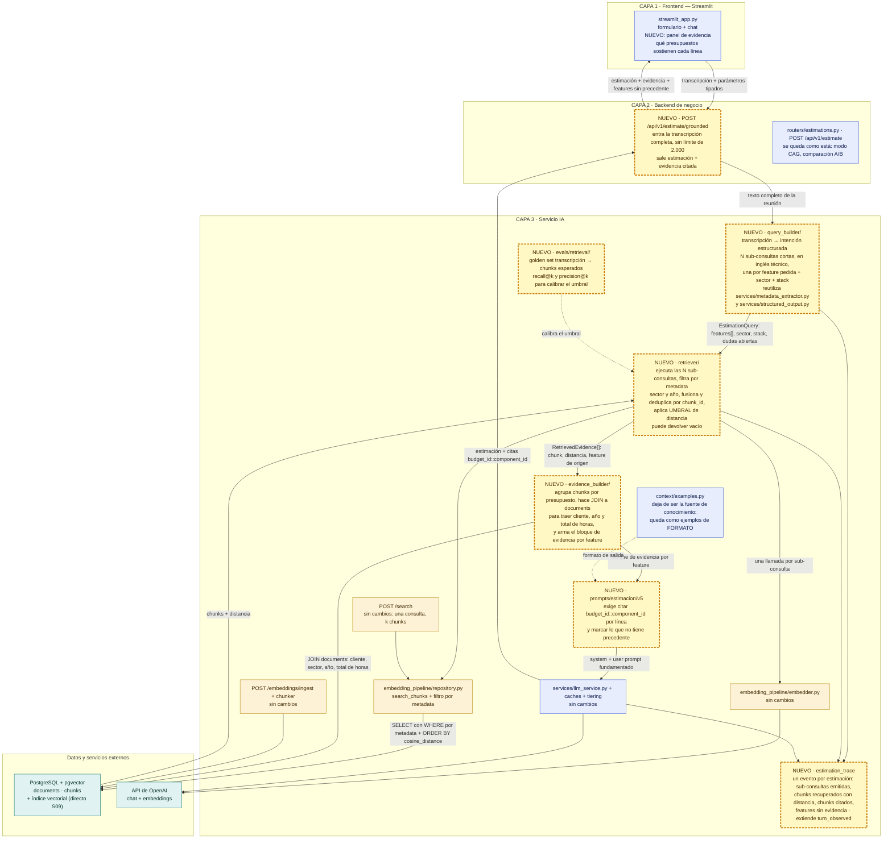

# Diagnóstico arquitectónico del servicio IA — pre-work sesión 09

**Proyecto:** `estimador-cag/` (estimador de proyectos de software a partir de transcripciones de reunión)
**Estado de partida:** cierre de la sesión 08 (rama `session-08/postgres-pgvector`)
**Fecha del diagnóstico:** 2026-10-30
**Autor:** Fernando Flores V

Este documento no añade código al pipeline. Ejecuta el sistema tal como quedó al cierre de la sesión 08
contra una transcripción realista, registra lo que pasa, y razona sobre la distancia entre eso y una
estimación fundamentada.

## Cómo reproducir todo lo que hay aquí

```bash
cd estimador-cag
docker compose up -d postgres api                        # Postgres 16 + pgvector y la API
docker compose run --rm api alembic upgrade head         # documents + chunks
uv run python scripts/ingest_corpus.py                   # 15 presupuestos -> 15 documents / 73 chunks
uv run python examples/trace_02_ambiguous.py             # los 8 pasos que sostienen la sección 2
```

El output literal de ese último comando está en
[`estimador-cag/examples/trace_02_ambiguous.out.txt`](estimador-cag/examples/trace_02_ambiguous.out.txt).
Las distancias de una reingesta se mueven en el cuarto decimal (la API de embeddings no es bit-exacta entre
llamadas; está documentado en el README de la sesión 08), así que los números de este documento se leen al
tercer decimal.

> **Nota sobre el material.** El enunciado dice que las tres transcripciones de ejemplo vienen con el
> material del curso, pero no llegaron al repo. Están **reconstruidas** a partir de las descripciones del
> propio enunciado (clara / ambigua / difícil) y guardadas en
> [`estimador-cag/examples/transcripts/`](estimador-cag/examples/transcripts/), con la procedencia anotada en
> el README de ese directorio. El trace de la sección 2 no depende del contenido del fichero: si aparece el
> original, se repite el mismo comando.

---

## 1. Diagrama de la arquitectura actual

### 1.1 Las tres capas y los dos caminos



### 1.2 Qué módulo es qué (nombres del enunciado contra ficheros de este repo)

El enunciado habla de `ingest/`, `embedding_pipeline/` y `storage/`. En este proyecto esas
responsabilidades existen, pero con otra distribución de ficheros:

| Responsabilidad del enunciado | Dónde vive aquí | Estado al cierre de S08 |
|---|---|---|
| `ingest/` | `scripts/ingest_corpus.py` (cliente) + `POST /embeddings/ingest` (`embedding_pipeline/router.py`) + `embedding_pipeline/schemas.py` (`Budget`, `IngestRequest`) | Operativo. Solo acepta **presupuestos** con el esquema `Budget`; no ingesta transcripciones |
| `embedding_pipeline/` | `embedding_pipeline/chunker.py`, `embedder.py`, `similarity.py` | Operativo. Chunker estructural (1 componente = 1 chunk, 77–207 tokens), embedder por lotes con coste medido |
| `storage/` | `app/db/models.py`, `app/db/session.py`, `embedding_pipeline/repository.py`, `alembic/versions/0001_initial_schema.py` | Operativo. `documents` + `chunks`, `Vector(1536)`, JSONB con GIN, cascada, **sin índice vectorial** (baseline deliberado) |
| Endpoints HTTP de hoy | `GET /health`, `POST /api/v1/estimate`, `GET /api/v1/prompts`, `POST /api/v1/sessions` (+`GET`/`DELETE`/`.../estimate`), `POST /embeddings/ingest`, `POST /search` | 9 rutas. Ninguna une los dos caminos |
| Generación | `context/examples.py`, `prompts/estimacion/v4/`, `services/llm_service.py`, `services/structured_output.py` | Operativo desde la sesión 04, **alimentado por 3 ejemplos hardcoded**, no por la base de datos |

### 1.3 En qué punto se queda corto el flujo si llega una transcripción

Tres cortes concretos, los tres verificados en la sección 2:

1. **No hay puerta de entrada.** La transcripción solo puede entrar por `POST /api/v1/estimate` o por
   `POST /api/v1/sessions/{id}/estimate`, y ninguno de los dos habla con Postgres. `POST /search` sí habla
   con Postgres, pero su contrato es `query: str` con `max_length=2000`, y la transcripción del trace tiene
   8.220 caracteres.
2. **No hay etapa de consulta.** Lo que se vectoriza es literalmente el texto que llega. No hay ninguna
   pieza que convierta "una reunión de 2.384 tokens" en "lo que el cliente quiere construir".
3. **No hay etapa de aumento.** `POST /search` devuelve JSON a quien llama. Ese JSON no tiene ningún
   consumidor dentro del sistema: hoy lo lee una persona con `curl`. La plantilla de prompt sigue leyendo
   `context/examples.py`.

---

## 2. Trace anotado de `02_ambiguous.txt`

La transcripción: una distribuidora familiar de recambios de automoción (Recambios Hermanos Belmonte).
Durante 8.220 caracteres el cliente habla de la historia de la empresa, del teléfono, de un Excel, de los
albaranes, de los chóferes, de una web que les salió mal, de un competidor, de su jubilación, de la LOPD, de
una feria y de si su empleada aprenderá o no. **Lo que quiere construir aparece en tres frases**:

> *Tomás:* Lo que de verdad necesitamos es que el taller entre con su usuario, vea su precio —porque cada
> taller tiene su tarifa según el volumen que nos compra, hay cinco o seis escalones— y pueda hacer el pedido
> sin llamarnos.
> *Pilar:* Y que lo que pida entre en el Sage solo […]
> *Tomás:* […] necesitamos que nos pida presupuesto por la web, que llegue a mi hija o al comercial […] y que
> vuelva aprobado o rechazado.

Esas tres frases son **206 tokens de 2.384**: el 8,6 % del texto. Guárdese ese número, porque explica casi
todo lo que viene después.

En el corpus existe el presupuesto que debería ganar: **BUD-2023-012** (*B2B marketplace for hardware
suppliers with tiered pricing, quotes and ERP integration*, sector `ecommerce`, Laravel, 2023, 520 h) con
exactamente esos componentes: `PRICE-002` *Tiered pricing and customer groups* (90 h), `QUOTE-003`
*Request-for-quote workflow* (110 h), `ERP-004` *ERP integration* (140 h), `VEND-001` *Vendor onboarding and
catalog upload* (100 h), `SHIP-005` *Shipping and pallet logistics* (80 h). Lo llamo el **comparable** a
partir de aquí.

### Paso 0 — Estado del sistema

```bash
curl -s http://localhost:8000/health | python3 -m json.tool
```

```json
{
    "status": "ok",
    "service": "Estimador CAG",
    "version": "0.1.0",
    "provider": "openai",
    "model": "gpt-4o-mini",
    "llm_configured": true,
    "prompt_template": "estimacion/v4",
    "session_max_turns": 6,
    "active_sessions": 0,
    "embedding_model": "text-embedding-3-small",
    "embeddings_configured": true,
    "database": "postgresql+asyncpg://estimator@postgres:5432/estimator",
    "timestamp": "2026-10-30T23:12:24.363461Z"
}
```

> **Observación.** El servicio se declara sano y con los dos caminos configurados: `llm_configured` y
> `embeddings_configured` a `true`. Nada en `/health` indica que esos dos caminos no se hablan entre sí.

### Paso 1 — Pasarle la transcripción completa al endpoint de búsqueda: 422

```bash
python3 -c "
import json, pathlib
t = pathlib.Path('examples/transcripts/02_ambiguous.txt').read_text(encoding='utf-8')
print(json.dumps({'query': t, 'k': 5}, ensure_ascii=False))
" > /tmp/search_full.json

curl -s -X POST http://localhost:8000/search \
  -H 'Content-Type: application/json' \
  -d @/tmp/search_full.json -w '\nHTTP %{http_code}\n'
```

```
HTTP 422
{
  "detail": [
    {
      "type": "string_too_long",
      "loc": ["body", "query"],
      "msg": "String should have at most 2000 characters",
      "input": "Reunión de toma de requisitos — Recambios Hermanos Belmonte, S.L. — 21/10/2026 […los 8.220 caracteres de la transcripción, devueltos íntegros en el cuerpo del error…]",
      "ctx": { "max_length": 2000 }
    }
  ]
}
```

> **Observación.** El primer intento ni llega a la base de datos. El contrato de `POST /search` (sesión 08)
> es `query: str = Field(min_length=1, max_length=2000)`: está pensado para una consulta escrita por una
> persona, no para un documento. La transcripción es 4,1× el límite. Y no hay alternativa: **no existe
> ningún endpoint que vectorice texto libre** — `POST /embeddings/ingest` exige un `Budget` completo con
> `budget_id`, `components`, `estimated_hours`… Para seguir el trace hay que bajar por debajo del HTTP.

### Paso 2 — Vector de la transcripción completa (por módulo, no por HTTP)

```bash
uv run python examples/trace_02_ambiguous.py   # PASO 1 del script
```

```json
{
  "label": "full_transcript",
  "input_characters": 8220,
  "input_tokens": 2384,
  "dimensions": 1536,
  "first_component": 0.02264404296875,
  "last_component": 0.0139007568359375,
  "first_3": [0.02264404296875, 0.053253173828125, -0.03302001953125],
  "last_3": [0.021575927734375, 0.048187255859375, 0.0139007568359375],
  "l2_norm": 0.99951
}
```

> **Observación.** 2.384 tokens de conversación colapsados en 1.536 números con norma 1. Lo que representa
> ese vector no es "un portal B2B con tarifas por cliente": es *el promedio* de una reunión en la que se
> habla de furgonetas, de un Excel, de la LOPD, de una feria y, de pasada, de un portal B2B. El modelo no
> tiene forma de saber qué parte del texto era el encargo y qué parte era contexto social. La norma 1
> confirma que `text-embedding-3-small` devuelve vectores normalizados, así que coseno y producto escalar
> ordenan igual (lo que ya asumía `embedding_pipeline/similarity.py`).

### Paso 3 — Top-5 con ese vector

```bash
uv run python examples/trace_02_ambiguous.py   # PASO 2 del script
```

```
1. d=0.6067  chunk_id=33  doc=7   BUD-2025-008  I18N-004   Bilingual storefront (Spanish and Catalan)  [ecommerce]   40 h
2. d=0.6570  chunk_id=29  doc=6   BUD-2023-012  SHIP-005   Shipping and pallet logistics               [ecommerce]   80 h
3. d=0.6583  chunk_id=26  doc=6   BUD-2023-012  PRICE-002  Tiered pricing and customer groups          [ecommerce]   90 h
4. d=0.6612  chunk_id=27  doc=6   BUD-2023-012  QUOTE-003  Request-for-quote workflow                  [ecommerce]  110 h
5. d=0.6631  chunk_id=69  doc=15  BUD-2024-009  ROUTE-001  Route optimisation engine                   [logistics]  150 h
```

Chunk a chunk, con el contenido real que hay en `chunks.content`:

| # | Presupuesto | Sector / stack | Componente | ¿Relevante para lo que pide el cliente? |
|---|---|---|---|---|
| 1 | BUD-2025-008 · panadería online | `ecommerce` / WordPress | *Bilingual storefront (Spanish and Catalan)* — traducción del catálogo y los emails al catalán, 40 h, complejidad baja | **No. Es el peor chunk posible y es el primero.** El cliente no ha dicho una palabra sobre idiomas ni traducciones. Mi hipótesis: de los 73 chunks, solo **dos** contienen la palabra "Spanish" —este, que habla de traducir al catalán, y `PSD2-002`, que habla de *Spanish banks*— y este es el único que trata el idioma como idioma. La transcripción está en español: gana por alineamiento superficial, no por contenido |
| 2 | BUD-2023-012 · marketplace B2B | `ecommerce` / Laravel | *Shipping and pallet logistics* — cálculo de portes por peso, volumen y palés, 80 h | **Parcialmente sí**, y por casualidad: Quique mencionó los palés de aceite y las baterías ADR. Pero es un detalle de la reunión, no el encargo. Aparece además en **los tres rankings** del trace, y es el 2.º chunk más cercano al centroide del corpus (d=0,2154): es un chunk genérico que sale casi con cualquier consulta |
| 3 | BUD-2023-012 · marketplace B2B | `ecommerce` / Laravel | *Tiered pricing and customer groups* — precios por grupo de cliente con escalones, 90 h | **Sí. Es el chunk exacto.** "Cada taller tiene su tarifa según el volumen que nos compra, hay cinco o seis escalones" es literalmente este componente. Está en el puesto 3, a 0,0516 del falso positivo que lo adelanta |
| 4 | BUD-2023-012 · marketplace B2B | `ecommerce` / Laravel | *Request-for-quote workflow* — petición de presupuesto, aprobación y conversión a pedido, 110 h | **Sí.** Es la segunda frase útil del cliente, la de "que nos pida presupuesto por la web […] y que vuelva aprobado o rechazado" |
| 5 | BUD-2024-009 · última milla | `logistics` / Node | *Route optimisation engine* — optimización de rutas de reparto, 150 h | **No.** Es el ruido convertido en resultado: entra por los chóferes, las dos rutas y los albaranes, que es de lo que más se habla en la reunión y lo único que el cliente dijo explícitamente que **no** le aplica ("nosotros hacemos un radio de sesenta kilómetros, no es Amazon"). Y es el componente más caro de los cinco |

> **Observación.** Precisión en el top-5: **2 de 5** claramente relevantes, 1 parcial, 2 falsos positivos, y
> el falso positivo más flagrante en primera posición. Falta `ERP-004` (la frase "que entre en el Sage solo")
> y falta `VEND-001`. Los 5 chunks vienen de **3 presupuestos y 2 sectores distintos**: sumar sus horas —una
> panadería WordPress, un marketplace B2B y una plataforma de última milla— no daría una estimación, daría un
> número sin significado.

### Paso 4 — ¿Cuánto significan esas distancias? Dispersión contra todo el corpus

```bash
uv run python examples/trace_02_ambiguous.py   # PASO 2b del script
```

```json
{
  "chunks_scored": 73,
  "min_distance": 0.606656,
  "max_distance": 0.841863,
  "mean_distance": 0.728062,
  "stdev_distance": 0.04165,
  "range_max_minus_min": 0.235207,
  "top5_minus_top1": 0.056486
}
```

> **Observación.** El corpus entero vive en una banda de 0,235 de ancho y el top-5 ocupa 0,056 de esa banda:
> **el 24 %**. El mejor chunk está a 0,607 y la media del corpus a 0,728: el "ganador" es solo 0,12 mejor que
> un chunk tomado al azar. Con estos números no se puede poner un umbral ("devuelve solo lo que esté por
> debajo de 0,5" no devolvería nada), no se puede ponderar por similitud, y no se puede distinguir un acierto
> de un empate. El endpoint, sin embargo, devuelve los 5 con el mismo aspecto y sin ninguna señal de
> confianza.

### Paso 5 — Lo que sí cabe por HTTP: los primeros 2.000 caracteres

```bash
python3 -c "
import json, pathlib
t = pathlib.Path('examples/transcripts/02_ambiguous.txt').read_text(encoding='utf-8')[:2000]
print(json.dumps({'query': t, 'k': 5}, ensure_ascii=False))
" > /tmp/search_trunc.json

curl -s -X POST http://localhost:8000/search \
  -H 'Content-Type: application/json' \
  -d @/tmp/search_trunc.json -w '\nHTTP %{http_code}\n'
```

Respuesta cruda (recortada solo en el eco de `query` y en los chunks 4 y 5, que se listan debajo en la tabla):

```json
{
  "query": "Reunión de toma de requisitos — Recambios Hermanos Belmonte, S.L. — 21/10/2026\n\nAsistentes: Tomás Belmonte (gerente), Pi […recortado…]",
  "k": 5,
  "search_time_ms": 584,
  "results": [
    {
      "chunk_id": 33,
      "document_id": 7,
      "chunk_type": "budget_component",
      "content": "[Project: Online bakery shop with next-day delivery slots, subscriptions and WooCommerce migration]\n[Client sector: ecommerce | Year: 2025 | Main tech: wordpress]\n\nComponent: Bilingual storefront (Spanish and Catalan)\nDescription: Translation of catalog, checkout and transactional emails into Catalan with language switch and localised URLs, keeping a single order database.\nTech stack: wordpress, wpml\nComplexity: low\nEstimated hours: 40",
      "distance": 0.5886377296368508,
      "metadata": {
        "year": 2025,
        "budget_id": "BUD-2025-008",
        "chunk_ref": "BUD-2025-008::I18N-004",
        "complexity": "low",
        "tech_stack": ["wordpress", "wpml"],
        "token_count": 89,
        "component_id": "I18N-004",
        "client_sector": "ecommerce",
        "client_country": "ES",
        "component_name": "Bilingual storefront (Spanish and Catalan)",
        "estimated_hours": 40,
        "main_technology": "wordpress"
      }
    },
    {
      "chunk_id": 29,
      "document_id": 6,
      "chunk_type": "budget_component",
      "content": "[Project: B2B marketplace for hardware suppliers with tiered pricing, quotes and ERP integration]\n[Client sector: ecommerce | Year: 2023 | Main tech: laravel]\n\nComponent: Shipping and pallet logistics\nDescription: Shipping cost calculation by weight, volume and pallet count, integration with two carriers for labels and tracking, and delivery slot selection at checkout.\nTech stack: laravel, mysql\nComplexity: medium\nEstimated hours: 80",
      "distance": 0.6344237672365524,
      "metadata": {
        "year": 2023,
        "budget_id": "BUD-2023-012",
        "chunk_ref": "BUD-2023-012::SHIP-005",
        "complexity": "medium",
        "tech_stack": ["laravel", "mysql"],
        "token_count": 92,
        "component_id": "SHIP-005",
        "client_sector": "ecommerce",
        "client_country": "ES",
        "component_name": "Shipping and pallet logistics",
        "estimated_hours": 80,
        "main_technology": "laravel"
      }
    }
  ]
}
```

El ranking completo de esta llamada:

```
1. d=0.5886  chunk_id=33  BUD-2025-008  I18N-004   Bilingual storefront (Spanish and Catalan)  [ecommerce]   40 h
2. d=0.6344  chunk_id=29  BUD-2023-012  SHIP-005   Shipping and pallet logistics               [ecommerce]   80 h
3. d=0.6475  chunk_id=34  BUD-2025-008  RPT-005    Sales export to Excel                       [ecommerce]   40 h
4. d=0.6493  chunk_id=68  BUD-2025-017  RPT-005    Stock reporting                             [industrial]  40 h
5. d=0.6532  chunk_id=27  BUD-2023-012  QUOTE-003  Request-for-quote workflow                  [ecommerce]  110 h
```

> **Observación.** El único camino que el sistema permite hoy es **estrictamente peor**: la precisión baja de
> 2/5 a **1/5**. `PRICE-002` —el chunk exacto— se cae del top-5. Entran *Sales export to Excel* y *Stock
> reporting* (40 h cada uno, complejidad baja) porque los primeros 2.000 caracteres son justo la parte de la
> reunión donde se habla del Excel de Pilar y del almacén; las tres frases útiles están en el carácter 5.400
> y más allá, fuera del recorte. Truncar una transcripción por el principio es quedarse con las
> presentaciones. De paso: `search_time_ms: 584` no mide la base de datos — el seq scan sobre 73 filas es
> submilisegundo; esos 584 ms son casi enteramente la llamada a la API de embeddings.

### Paso 6 — Control: la intención del cliente escrita a mano

Para saber si el problema está en el corpus o en la consulta, ejecuto la misma búsqueda con una frase que
dice lo que el cliente quiere, escrita a mano a partir de sus tres frases útiles. Esto **no** es una pieza
del sistema: es el control del experimento.

```bash
curl -s -X POST http://localhost:8000/search \
  -H 'Content-Type: application/json' \
  -d '{"query": "B2B web portal where workshop customers log in, see their own tier price based on purchase volume, place orders that land in the ERP, and request a quote for parts without a list price", "k": 5}'
```

```
1. d=0.3665  chunk_id=26  BUD-2023-012  PRICE-002  Tiered pricing and customer groups     [ecommerce]   90 h
2. d=0.3851  chunk_id=27  BUD-2023-012  QUOTE-003  Request-for-quote workflow             [ecommerce]  110 h
3. d=0.4107  chunk_id=28  BUD-2023-012  ERP-004    ERP integration (SAP Business One)     [ecommerce]  140 h
4. d=0.4227  chunk_id=25  BUD-2023-012  VEND-001   Vendor onboarding and catalog upload   [ecommerce]  100 h
5. d=0.4242  chunk_id=29  BUD-2023-012  SHIP-005   Shipping and pallet logistics          [ecommerce]   80 h
```

```json
{ "chunks_scored": 73, "min_distance": 0.366496, "mean_distance": 0.660847,
  "stdev_distance": 0.082204, "range_max_minus_min": 0.410944 }
```

> **Observación. Este es el resultado más importante del trace.** 39 tokens escritos a mano baten a 2.384
> tokens de transcripción real: la mejor distancia pasa de **0,607 a 0,367** (similitud coseno de 0,393 a
> 0,634, un 61 % mejor), la precisión pasa de **2/5 a 5/5**, el top-5 entero sale del comparable correcto y
> aparecen los dos chunks que faltaban (`ERP-004` y `VEND-001`). La desviación típica del corpus casi se
> dobla (0,042 → 0,082): el ranking **empieza a discriminar**. Conclusión: el corpus está bien, el chunker
> está bien, el SQL está bien. **Lo que falta es la etapa que convierte una reunión en una consulta.**

### Paso 7 — Ablación: ¿el ranking lo decide la señal o el ruido?

```bash
uv run python examples/trace_02_ambiguous.py   # PASO 5 del script
```

Vectorizo por separado (a) solo las tres frases útiles y (b) la transcripción **sin** esas tres frases:

```
SOLO SEÑAL  —  740 caracteres / 206 tokens
1. d=0.6140  id=26  BUD-2023-012  PRICE-002   Tiered pricing and customer groups          [ecommerce]
2. d=0.6164  id=27  BUD-2023-012  QUOTE-003   Request-for-quote workflow                  [ecommerce]
3. d=0.6320  id=29  BUD-2023-012  SHIP-005    Shipping and pallet logistics               [ecommerce]
4. d=0.6605  id=28  BUD-2023-012  ERP-004     ERP integration (SAP Business One)          [ecommerce]
5. d=0.6645  id=33  BUD-2025-008  I18N-004    Bilingual storefront (Spanish and Catalan)  [ecommerce]

SOLO RUIDO  —  7.478 caracteres / 2.178 tokens
1. d=0.6106  id=33  BUD-2025-008  I18N-004    Bilingual storefront (Spanish and Catalan)  [ecommerce]
2. d=0.6584  id=29  BUD-2023-012  SHIP-005    Shipping and pallet logistics               [ecommerce]
3. d=0.6615  id=34  BUD-2025-008  RPT-005     Sales export to Excel                       [ecommerce]
4. d=0.6619  id=26  BUD-2023-012  PRICE-002   Tiered pricing and customer groups          [ecommerce]
5. d=0.6649  id=69  BUD-2024-009  ROUTE-001   Route optimisation engine                   [logistics]
```

Solape de ids con el ranking de la transcripción completa (`[33, 29, 26, 27, 69]`):

```json
{
  "full_vs_noise_overlap":  [26, 29, 33, 69],
  "full_vs_signal_overlap": [26, 27, 29, 33]
}
```

> **Observación.** Con solo las tres frases, los **cuatro primeros** chunks son del comparable correcto. Con
> solo el ruido, el ranking es **el mismo que el de la transcripción completa**: mismo primero (33), mismo
> segundo (29), 4 de 5 ids compartidos y el falso positivo de logística en quinto. Es decir: el 8,6 % del
> texto que contenía el encargo **no influye en el resultado**. El vector de la transcripción es el vector
> de su ruido. Esto no es una intuición sobre RAG, es una medición: la dilución no "empeora un poco" el
> retrieval, lo decide del todo.

### Paso 8 — Efecto del idioma y del registro

```bash
uv run python examples/trace_02_ambiguous.py   # PASO 6 del script
```

Misma intención, tres formas de escribirla; sigo la distancia de `PRICE-002`, el chunk exacto:

| Formulación de la consulta | Tokens | d(`PRICE-002`) | Top-1 | Separación top-1 → top-3 |
|---|---|---|---|---|
| Las 3 frases del cliente, literales (español, conversacional) | 206 | **0,6140** | `PRICE-002` ✔ | 0,0180 |
| La intención reescrita en español técnico | 48 | **0,4591** | `QUOTE-003` | **0,0006** |
| La intención reescrita en inglés técnico | 39 | **0,3665** | `PRICE-002` ✔ | 0,0442 |

> **Observación.** Dos efectos que se suman y se pueden separar: reescribir la charla como enunciado técnico
> vale **−0,155**, y traducir ese enunciado al inglés del corpus vale **otros −0,093**. Total: −0,247, dos
> tercios de la mejora del paso 6. Y un detalle incómodo en la fila del medio: con la consulta en español los
> tres primeros caben en **0,0006** (0,4585 / 0,4588 / 0,4591). A esa escala el orden no lo decide el
> significado, lo decide el ruido numérico del modelo de embeddings — el mismo ruido de cuarto decimal que ya
> documentamos entre reingestas en la sesión 08. Un *reranker* sobre ese orden estaría reordenando azar.

### Paso 9 — ¿Y qué devuelve hoy el sistema si le pides la estimación?

El único endpoint que produce una estimación es el de la sesión 04, que no sabe que Postgres existe.

```bash
python3 -c "
import json, pathlib
t = pathlib.Path('examples/transcripts/02_ambiguous.txt').read_text(encoding='utf-8')
print(json.dumps({'transcription': t, 'project_name': 'Portal B2B Recambios Belmonte',
                  'project_type': 'web', 'hourly_rate_eur': 50,
                  'estimation_mode': 'equilibrada', 'detail_level': 'completa'}, ensure_ascii=False))
" > /tmp/estimate.json

curl -s -X POST http://localhost:8000/api/v1/estimate \
  -H 'Content-Type: application/json' -d @/tmp/estimate.json
```

```json
{
  "model": "gpt-4o-mini",
  "provider": "openai",
  "usage": {
    "input_tokens": 5421, "output_tokens": 446, "total_tokens": 5867,
    "cost": { "input_usd": 0.000813, "output_usd": 0.000268, "total_usd": 0.001081 }
  },
  "prompt": {
    "template": "estimacion", "version": "v4",
    "system_prompt_chars": 12351, "user_prompt_chars": 9118, "transcription_chars": 8219
  },
  "guardrails": null,
  "generated_at": "2026-10-30T23:15:35.614705Z"
}
```

Y la estimación (extracto):

```markdown
## Estimación: Portal B2B Recambios Belmonte

### Desglose de tareas:
1. Análisis funcional y modelado de datos: 20 horas
2. Diseño UI/UX de la aplicación web: 40 horas
3. Desarrollo del backend (API para gestión de usuarios, pedidos y presupuestos): 60 horas
4. Integración con Sage para la gestión automática de pedidos: 50 horas
5. Integración con TecDoc para búsqueda de piezas: 40 horas
6. Desarrollo del frontend web (listados, formularios de pedido y presupuesto): 70 horas
7. Testing y QA: 30 horas
8. Despliegue y documentación: 10 horas

**Subtotal de tareas: 320 horas**
**Contingencia (10 %): 32 horas**
**Total estimado: 352 horas**
**Coste estimado: 17.600 €**
```

> **Observación.** La estimación es **plausible y está completamente desfundamentada**. Los 5.421 tokens de
> entrada son 12.351 caracteres de system prompt (los **3 ejemplos hardcoded** de `context/examples.py`) más
> la transcripción: **cero chunks**. Los 73 componentes de presupuesto que hay en Postgres no han participado.
> Y el número se nota: el desglose funcional generado (líneas 3–6) suma **220 h**, mientras que los cinco
> componentes funcionales equivalentes del comparable `BUD-2023-012` suman **520 h** — un factor **2,4×**.
> La integración con el ERP se estima en 50 h cuando el histórico la cobró a 140 h. No sé quién tiene razón;
> sí sé que el sistema **tenía el dato y no lo miró**, y que la estimación no cita ni un `budget_id`, así que
> nadie puede auditarla.

---

## 3. Diagnóstico: cinco fallos identificados

### Fallo 1 — El vector de la transcripción es el vector de su ruido

- **Problema observado.** El top-5 de la transcripción completa (paso 3) es `[33, 29, 26, 27, 69]` y el
  top-5 del **ruido solo** —la misma transcripción sin las tres frases que dicen qué quiere el cliente— es
  `[33, 29, 34, 26, 69]`: mismo primero, mismo segundo, 4 de 5 ids compartidos (paso 7). Las tres frases
  útiles son 206 de 2.384 tokens (8,6 %) y **no cambian el ranking**. Vectorizadas solas, en cambio, colocan
  al comparable correcto en los cuatro primeros puestos.
- **Causa probable.** Un embedding de 1.536 dimensiones es un promedio: no distingue encargo de contexto
  social. Al vectorizar el documento entero, los 2.178 tokens de historia familiar, albaranes y chóferes
  dominan la media y el 8,6 % que importaba queda enterrado. No existe ninguna pieza entre "llega la
  transcripción" y "se llama al embedder".
- **Propuesta de solución.** Una etapa de **construcción de consulta** que, antes de vectorizar, extraiga de
  la transcripción qué quiere construir el cliente y emita consultas cortas y específicas por cada cosa
  pedida. Es la etapa que falta, no un parámetro que ajustar.

### Fallo 2 — El contrato de búsqueda no admite documentos, y el único recorte posible es el peor

- **Problema observado.** `POST /search` con los 8.220 caracteres devuelve **422 `string_too_long`** sin
  llegar a la base de datos (paso 1); el límite es `max_length=2000`. Recortando a los primeros 2.000
  caracteres —lo único que el contrato permite— la precisión baja de 2/5 a **1/5** y `PRICE-002`, el chunk
  exacto, se cae del top-5 (paso 5). Tampoco hay salida por otro lado: ningún endpoint vectoriza texto
  libre, `POST /embeddings/ingest` exige un `Budget` completo.
- **Causa probable.** El contrato de la sesión 08 se diseñó para una consulta tecleada por una persona
  (`"payment gateway with 3-D Secure"`), que es el caso de uso del ejercicio. El sistema no tiene ningún
  camino de entrada para un documento largo ni la noción de "trocear la entrada antes de buscar": el chunker
  existe, pero solo sabe trocear presupuestos JSON.
- **Propuesta de solución.** Separar el endpoint de búsqueda (una consulta, k chunks) del caso de uso real
  (un documento, una estimación): un endpoint de estimación fundamentada que acepte la transcripción
  completa y que internamente genere las consultas cortas que `/search` sí sabe resolver.

### Fallo 3 — Las distancias no se pueden interpretar, y el sistema nunca dice "no tengo nada parecido"

- **Problema observado.** Con el vector de la transcripción, los 73 chunks caen entre 0,607 y 0,842 (media
  0,728, desviación 0,042) y el top-5 ocupa 0,056, el **24 % del rango** (paso 4). El mejor chunk es solo
  0,12 mejor que la media del corpus. Con la consulta de intención en español, los tres primeros caben en
  **0,0006** (paso 8): a esa escala el orden lo decide el ruido de cuarto decimal del modelo, el mismo que
  ya documentamos entre reingestas en la sesión 08. Y el endpoint devuelve siempre k resultados con el mismo
  aspecto: el falso positivo de la panadería (0,607) y el acierto del comparable (0,367 con la consulta
  buena) salen con el mismo esquema, sin ningún campo que diga cuál merece confianza.
- **Causa probable.** No hay umbral, ni normalización, ni calibración: `search_chunks` ordena por
  `cosine_distance` y corta en `LIMIT k`. Y no hay ningún punto de referencia medido —ningún *golden set*—
  contra el que saber qué distancia es "buena" para este corpus.
- **Propuesta de solución.** Un umbral de distancia calibrado con un conjunto de casos etiquetados
  (transcripción → chunks que deberían salir), y que la respuesta del retrieval pueda estar **vacía**: el
  cliente pide un buscador por matrícula contra TecDoc y en el corpus no hay nada de catálogos de
  automoción; el sistema debería poder decirlo en lugar de rellenar con los cinco menos lejanos.

### Fallo 4 — Asimetría entre la consulta y el corpus: español conversacional contra inglés técnico

- **Problema observado.** Siguiendo `PRICE-002`, el chunk exacto (paso 8): las tres frases del cliente
  literales dan **0,6140**; reescritas como enunciado técnico en español, **0,4591**; el mismo enunciado en
  inglés, **0,3665**. Reescribir vale −0,155 y traducir otros −0,093. Y el falso positivo que gana el
  ranking de la transcripción completa es, de los 73 chunks, el único que trata un idioma humano **como
  idioma** (*Bilingual storefront (Spanish and Catalan)*, traducción al catalán de una panadería WordPress,
  40 h): `grep` sobre `chunks.content` devuelve solo otro chunk con la palabra "Spanish", y ahí se refiere
  a *Spanish banks*.
- **Causa probable.** El corpus se construye con `chunker.render_text`, que genera inglés técnico y
  esquemático (`Component: … Description: … Tech stack: … Complexity: …`), mientras que la entrada es
  castellano hablado con interrupciones. `text-embedding-3-small` es multilingüe, pero no borra la
  diferencia de idioma ni la de registro: la consulta y el documento viven en dos distribuciones distintas
  del mismo espacio.
- **Propuesta de solución.** Normalizar la consulta al idioma y al registro del corpus antes de vectorizar
  —generar el enunciado técnico en inglés en la propia etapa de construcción de consulta—, y de paso dejar
  anotado como pregunta para el directo si conviene además guardar una variante en español de cada chunk.

### Fallo 5 — Lo que se recupera no llega a la generación: la estimación sigue saliendo de tres ejemplos hardcoded

- **Problema observado.** `POST /api/v1/estimate` con esta transcripción devuelve una estimación completa de
  352 h / 17.600 € con 5.421 tokens de entrada, de los cuales 12.351 caracteres son el system prompt con los
  **3 ejemplos hardcoded** de `context/examples.py`, y **cero** chunks de Postgres (paso 9). El desglose
  funcional generado suma 220 h frente a las 520 h de los cinco componentes equivalentes del comparable
  `BUD-2023-012` —factor **2,4×**—, y la integración con el ERP se estima en 50 h cuando el histórico la
  cobró a 140 h. La estimación no cita ni un `budget_id`: no es auditable.
- **Causa probable.** Son dos pipelines paralelos que nunca se tocan (diagrama de la sección 1): el camino
  CAG se construyó entre las sesiones 02 y 06 con el contexto dentro del prompt, y el camino vectorial se
  construyó en las 07–08 con su propia puerta HTTP. El consumidor de `POST /search` hoy es una persona con
  `curl`, y la plantilla `estimacion/v4` sigue leyendo el módulo de Python. Además, `SearchResult` solo
  devuelve `document_id`: ni el cliente, ni el año, ni el total de horas del presupuesto padre, así que
  incluso teniendo los chunks habría que ir a buscar el contexto a `documents` con una segunda consulta.
- **Propuesta de solución.** Una etapa de **aumento** que agrupe los chunks recuperados por presupuesto,
  resuelva su documento padre y construya el bloque de evidencia que entra en el prompt en lugar de los
  ejemplos estáticos; y una versión nueva de la plantilla que **obligue a citar** `budget_id::component_id`
  en cada línea del desglose y a marcar explícitamente lo que no tiene precedente en el corpus.

---

## 4. Propuesta de evolución arquitectónica

### 4.1 Diagrama propuesto

Las cajas en **amarillo con borde discontinuo** son nuevas respecto al diagrama de la sección 1. Las azules y
naranjas ya existen y se reutilizan tal cual.



### 4.2 Responsabilidades, datos y la pieza crítica

`query_builder/` convierte la transcripción en **intención estructurada**: una consulta corta, en inglés
técnico, por cada cosa que el cliente quiere construir, más el sector y el stack mencionados. `retriever/`
recibe esa lista, lanza una búsqueda por feature filtrando por metadata, fusiona deduplicando por `chunk_id`
y descarta lo que no pase el umbral; devuelve chunks con su distancia y la feature que los trajo.
`evidence_builder/` los agrupa por presupuesto, resuelve el documento padre para traer cliente, año y total
de horas, y arma el bloque de evidencia que la plantilla `v5` inyecta en lugar de los tres ejemplos
estáticos; de ahí sale una estimación que cita `budget_id::component_id` por línea y declara lo que no tiene
precedente. `estimation_trace` observa las tres etapas con un solo evento. **La pieza crítica es
`query_builder/`**: el paso 6 mide que 39 tokens de intención bien escrita llevan la mejor distancia de 0,607
a 0,367 y la precisión de 2/5 a 5/5 sin tocar el retriever, y el paso 7 demuestra que sin esa etapa el
ranking lo decide el ruido.
Un reranker o un HNSW encima del ranking de hoy estaría reordenando azar.

---

## 5. Otros fallos (los que no entraron en los cinco)

Todos verificados con el mismo script, cambiando la transcripción:
`uv run python examples/trace_02_ambiguous.py --transcript examples/transcripts/0X_*.txt`.

1. **Una sola consulta no cubre un alcance múltiple.** En `01_clear.txt` el cliente nombra cuatro piezas
   explícitamente y `3DS-002` *3-D Secure 2 authentication flow* sale en el puesto **6**: con el `k=5` por
   defecto se pierde una de las cuatro cosas que el cliente dijo que no eran negociables. En `03_hard.txt`,
   **4 de los 5** chunks salen del presupuesto de teleconsulta (`BUD-2023-016`) mientras que el portal de
   resultados de laboratorio —lo que el cliente acabó priorizando— sale 4.º con el top-5 comprimido en 0,019.
   Un cliente que pide tres proyectos necesita tres recuperaciones, no una.
2. **Truncar sesga hacia el primer tema que se mencionó.** `03_hard.txt` recortado a 2.000 caracteres da
   **5 de 5** chunks de teleconsulta y el laboratorio desaparece del todo: los primeros 2.000 caracteres son
   justo donde se habla de vídeo, antes de que Nuria cambie la prioridad.
3. **El chunk del catalán es un imán del castellano.** *Bilingual storefront (Spanish and Catalan)* no solo
   gana en `02_ambiguous.txt`: en `01_clear.txt` (una transcripción de pagos, sector `finance`) aparece en el
   puesto **7**, por delante de cinco componentes de presupuestos de banca. Es el único chunk del corpus que trata un idioma
   humano como idioma, y la entrada siempre está en español.
4. **`SearchResult` no permite remontar al presupuesto padre.** Devuelve `document_id`, pero ni el cliente,
   ni el año, ni el `total_estimated_hours` del presupuesto: la metadata de documento vive en
   `documents.metadata` y hace falta una segunda consulta. Para fundamentar una estimación hay que saber que
   esas 90 h se cobraron en un proyecto de 520 h de 2023.
5. **Sin filtros por metadata** (deliberado en la sesión 08, se aborda en el directo): `search_chunks` no
   tiene `WHERE`, así que no se puede acotar por `client_sector` ni por `year` aunque el `query_builder`
   sepa que el cliente es de distribución y no de sanidad. El índice GIN sobre el JSONB ya está puesto.
6. **`search_time_ms` no mide lo que parece.** Los 584 ms del paso 5 son casi enteros la llamada a la API de
   embeddings; el sequential scan sobre 73 filas es submilisegundo. Como baseline para comparar un HNSW en el
   directo, esa métrica está contaminada: habría que medir el SQL por separado.
7. **El 422 devuelve la transcripción entera en el cuerpo del error** (8.220 caracteres), que acabarán en los
   logs de cualquier cliente que registre respuestas de error.
8. **No hay caché de embeddings de consulta.** El proyecto tiene `response_cache` y `semantic_cache` para el
   chat desde la sesión 03, pero cada `POST /search` paga una llamada a la API aunque la consulta se repita.
   Con N sub-consultas por estimación, eso se multiplica.
9. **No hay ninguna medida de calidad del retrieval.** No existe un conjunto de casos etiquetados ni
   `recall@k`, así que hoy cualquier cambio en el chunker, el modelo o el umbral se evalúa a ojo. Todo lo
   medido en este documento se ha medido a mano para este diagnóstico.

---

## 6. Preguntas que me llevo al directo

1. La etapa de construcción de consulta, ¿con un LLM (reutilizando `structured_output.py`, que ya extrae
   objetos tipados) o con algo más barato? Si es con LLM, ¿una llamada por estimación o una por feature?
2. Con el corpus en inglés y las transcripciones en español: ¿se normaliza la consulta al inglés, se guarda
   una variante en español de cada chunk, o se cambia a un modelo de embeddings con mejor alineamiento
   multilingüe? El trace mide −0,093 de diferencia; ¿es suficiente para justificar re-embeber el corpus?
3. Para fusionar los resultados de N sub-consultas, ¿mejor distancia por chunk o *reciprocal rank fusion*?
   Con distancias tan comprimidas (0,0006 entre el primero y el tercero en la consulta en español), ¿tiene
   sentido fusionar por puntuación o hay que fusionar por rango?
4. ¿Cómo se calibra el umbral de "no tengo evidencia" con un corpus de 73 chunks, y cuántos casos etiquetados
   hacen falta para que ese número signifique algo?
5. Si la evidencia recuperada contradice al cliente (histórico: 140 h para integrar el ERP; el cliente no
   quiere gastar), ¿quién gana en el prompt? ¿Se le deja al modelo o se resuelve en el `evidence_builder`?
